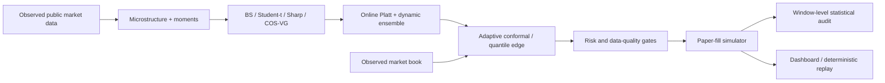

# Polymarket Pricing Research

[](https://github.com/arnav-goel10/polymarket-pricing-research/actions/workflows/ci.yml)
[](https://www.rust-lang.org/)
[](LICENSE)

A paper-only Rust platform for pricing, calibrating, replaying, and evaluating BTC five-minute prediction markets. It combines digital-option models, public real-time market data, online calibration, adaptive decision thresholds, portfolio risk limits, deterministic replay, and a WebSocket research dashboard.

> **Simulation boundary:** every decision and fill is a paper-fill simulation. The repository contains no wallet, signer, or credentialed exchange client, and no external order-submission path.

The system observes public market and reference feeds, estimates a calibrated probability for each contract, compares it with the observed order book, applies data-quality and portfolio-risk gates, and records the resulting hypothetical fill and P&amp;L. See the [publication boundary](docs/publication-boundary.md) for the exact capabilities included and excluded.

## Evidence at a glance

The versioned shadow ledger contains:

- **5,000** trade rows across **334** distinct five-minute windows.
- **500** scored observations per model across **7** model variants.
- Window-blocked bootstrap confidence intervals, Holm-adjusted hypothesis tests, Brier score, log loss, drawdown, and cost-sensitive diagnostics.
- A deterministic synthetic replay fixture for validating the pricing pipeline without network access or credentials.
- **174** automated Rust tests across pricing, feeds, market data, paper-fill simulation, risk, configuration, orchestration, and replay.

Reproduce the evidence:

```bash
python3 scripts/analyze_shadow_strategy.py --check --data fixtures/shadow-ledger-v1
python3 scripts/analyze_shadow_strategy.py --data fixtures/shadow-ledger-v1 --json demo/summary.json
cargo run -p app --bin replay -- fixtures/replay-sample.json --json
```

Open the [read-only research demo](demo/index.html) with `python3 -m http.server 8000 -d demo`, or use the GitHub Pages artifact generated by this repository.

## Architecture



| Crate | Responsibility |
| --- | --- |
| `poly_core` | Shared types, validated configuration, and paper-run invariants. |
| `pricing` | Digital pricing models, online Platt calibration, and model averaging. |
| `stats` | Rolling moments and statistical estimators. |
| `feeds` | Reference feeds and market-data normalization. |
| `market` | Market discovery and order-book representation. |
| `execution` | Paper-fill simulation, edge selection, risk limits, and audit records. |
| `app` | Orchestration, adaptive thresholds, persistence, dashboard, and replay. |

See [Architecture](docs/architecture.md), [Research methodology](docs/research-methodology.md), and the [paper-only publication boundary](docs/publication-boundary.md).

## Quick start

Requirements: stable Rust, Python 3.10+, and a network connection for observing public feeds.

```bash
cp .env.example .env
cargo run -p app -- --mode shadow
```

The dashboard binds to `http://127.0.0.1:8080` by default.

| Mode | Network data | Simulated decisions | External orders | Default |
| --- | ---: | ---: | ---: | ---: |
| `shadow` | Yes | All strategies | Impossible | Yes |
| `dry-run` | Yes | Selected strategy | Impossible | No |

```bash
cargo run -p app -- --mode dry-run
```

A non-loopback dry-run dashboard requires a random `CONTROL_TOKEN` of at least 32 characters. Without a token, the dashboard is read-only and `/control` is not registered.

## Offline replay

The replay binary consumes a versioned `ReplaySample`, validates every pricing context and probability, scores four model families, and compares Brier score and log loss with the market-mid baseline.

```bash
cargo run -p app --bin replay
cargo run -p app --bin replay -- fixtures/replay-sample.json --json
```

The bundled fixture is synthetic and supports reproducibility claims only. The versioned shadow ledger is the empirical evidence path.

## Research limitations

- Paper fills cannot reproduce queue movement, rejected requests, or execution latency.
- Model variants act on the same markets and are correlated alternatives.
- Online calibration can data-snoop unless parameters are frozen before a forward holdout.
- The checked-in ledger spans strategy revisions; results should be interpreted by version and window.

Read the generated [research audit](docs/research-audit.md) before interpreting any metric.

## Verification

```bash
cargo fmt --all --check
cargo clippy --workspace --all-targets -- -D warnings
cargo test --workspace --all-targets
python3 -m py_compile scripts/analyze_shadow_strategy.py
python3 scripts/analyze_shadow_strategy.py --check --data fixtures/shadow-ledger-v1
```

CI also performs a clean container build and fails if the committed research summary cannot be regenerated byte-for-byte.

## License

MIT. See [LICENSE](LICENSE).
