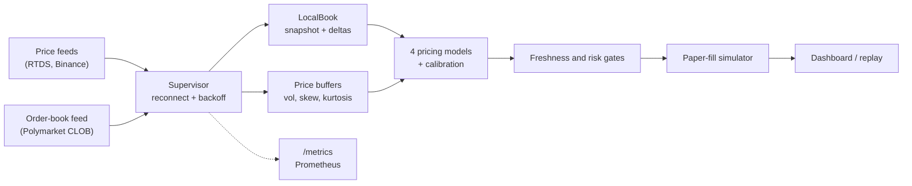

# Polymarket Pricing Research

[](https://github.com/arnav-goel10/polymarket-pricing-research/actions/workflows/ci.yml)
[](https://www.rust-lang.org/)
[](LICENSE)

A real-time market-data and pricing engine in Rust, run as a paper-only simulation. It reads public price and order-book feeds for Polymarket's five-minute Bitcoin up/down markets, rebuilds each order book locally, and estimates the probability of each outcome with four pricing models in about 1.5 microseconds. It never places an order.

| | |
| --- | ---: |
| Order-book messages parsed and applied, one core ([raw](bench-results/2026-11-09.txt)) | **1.7 million / s** |
| Full pipeline, every event re-priced by four models ([raw](bench-results/2026-11-09.txt)) | **630,000 events / s** |
| Per-event latency, p50 / p99 ([raw](bench-results/2026-11-09.txt)) | **1.9 µs / 3.1 µs** |
| Automated Rust tests, property-based and fault-injection included ([raw](bench-results/ci-local.txt)) | **216** |
| 150 s live check on the public feed ([raw](bench-results/live-book-health.txt)) | **67,920 book updates, 0 resyncs, 0 crossed books** |

Measured on an Apple M5 laptop. Method and full tables are under [Benchmarks](#benchmarks).

> **Simulation boundary:** every decision and fill is a paper-fill simulation. The project has no wallet, signer, credentialed exchange client or order-submission path. See the [publication boundary](docs/publication-boundary.md).


## Architecture



| Crate | Responsibility |
| --- | --- |
| `poly_core` | Shared types, validated configuration, reconnect backoff, lock-free feed counters. |
| `feeds` | WebSocket price feeds, the reconnect supervisor, and a scripted test server for fault injection. |
| `market` | Market discovery and order books. `LocalBook` rebuilds a book from a snapshot plus deltas and detects gaps, duplicates, malformed levels and crossed books. |
| `pricing` | Digital-option pricing models (Black-Scholes, Student-t, Cornish-Fisher, COS Variance-Gamma), online Platt calibration and model averaging. |
| `stats` | Rolling moments and volatility estimators. |
| `execution` | Paper-fill simulation, simulated strategy selection and paper risk limits. |
| `app` | Orchestration, the Axum dashboard and `/metrics`, event replay, benchmarks. |

More detail in [docs/architecture.md](docs/architecture.md).

## Reliability

Each feed runs under one supervisor. A dropped socket, 30 seconds of silence, or a book that can no longer be trusted ends the session. The supervisor then reconnects with exponential backoff from 250 ms to a 10 s cap, and a session that stayed up for 30 s resets the delay.

When the book cannot be trusted, it stops publishing and resyncs:

- **Gaps and duplicates.** With per-message sequence numbers, a repeated message is ignored and a missing one stops the book until a fresh snapshot arrives.
- **Malformed input.** One bad level (NaN, negative size, price outside 0 to 1) rejects the whole message, and the book resyncs.
- **Crossed books.** Polymarket reports fills as trades without removing the filled level, so a naive local book goes crossed several times a minute. Each delta carries the venue's own best bid and ask, and the book prunes through them before checking. A book that is still crossed triggers a resync.
- **Stale data.** A reference price older than 5 s or a book older than 3 s blocks every simulated decision, and `/metrics` flags any feed past its threshold.

How it is tested:

- **Property-based tests** ([`crates/market/tests/book_props.rs`](crates/market/tests/book_props.rs)) generate 512 random streams per property and replay them against a `BTreeMap` reference model, with duplicated, dropped, reordered, malformed and crossing messages. The book must match the reference exactly or report itself out of sync.
- **Fault injection** ([`crates/feeds/tests/fault_injection.rs`](crates/feeds/tests/fault_injection.rs), [`crates/market/tests/stream_faults.rs`](crates/market/tests/stream_faults.rs)) runs the real streaming loops against a local WebSocket server that drops connections mid-stream, sends garbage, goes silent, or refuses connections.
- **Live check.** Before the venue-top fix, the shadow app resynced 6 times in its first 90 seconds on the public feed. After it, 150 seconds and 67,920 book updates produced no resync and no crossed book ([`bench-results/live-book-health.txt`](bench-results/live-book-health.txt)).

The old stream code had two bugs these tests target. It published crossed books, and it turned a malformed snapshot into a partial book. Both are recorded in [`bench-results/legacy-book-bugs.txt`](bench-results/legacy-book-bugs.txt).

## Observability

`GET /metrics` serves Prometheus text format for every feed: messages per second, feed lag (receive time minus exchange timestamp), seconds since the last message, reconnects, resyncs, malformed frames, connection state and a stale flag. A scrape from a live run:

```text
poly_feed_messages_per_second{feed="clob_book"} 1092.4
poly_feed_lag_seconds{feed="clob_book"} 0.123
poly_feed_resyncs_total{feed="clob_book"} 0
poly_feed_stale{feed="clob_book"} 0
```

Logs are structured `tracing` events. `LOG_FORMAT=json` prints one JSON object per line with fields such as `feed`, `retry_in_ms` and `error`.

## Benchmarks

```bash
./scripts/bench.sh     # about 3 minutes; writes bench-results/<date>.txt
```

Results from [`bench-results/2026-11-09.txt`](bench-results/2026-11-09.txt) (Apple M5, 10 cores, 16 GB, rustc 1.99.1). Times are Criterion medians.

| Benchmark | Result |
| --- | ---: |
| Apply one level update to a 20-level book (`LocalBook`) | 17.3 ns |
| Order-book message, JSON parse to published book | 588 ns (1.70 M msg/s) |
| Price one contract, Black-Scholes | 8.7 ns |
| Price one contract, COS Variance-Gamma (64 terms) | 1.41 µs |
| Price one contract, four-model ensemble | 1.53 µs |
| Merge three feeds into one time-ordered stream | 118 M events/s |
| Replay pipeline, 100k events, re-price on every event | 633,000 events/s |

Per-event latency over 999,999 replayed events (`cargo run --release -p app --bin latency_report`):

| Events | p50 | p99 | p99.9 |
| --- | ---: | ---: | ---: |
| All | 1.9 µs | 3.1 µs | 9.9 µs |
| Order-book frames | 2.0 µs | 3.3 µs | 11.0 µs |
| Price ticks | 1.4 µs | 2.0 µs | 7.5 µs |

The replay input is a generated synthetic session with live-like message ratios: per second, one Chainlink tick, ten Binance ticks and twenty book deltas. The COS Variance-Gamma model takes most of the per-event time. Each latency sample includes one pair of clock reads, which is why the same run's wall-clock rate is 544,000 events/s against Criterion's 633,000.

## Research findings

I built the engine to find out whether digital-option models price these contracts well, and whether any apparent edge survives a correction for testing many correlated variants. They do the first. Nothing survives the second.

Source: the committed paper ledger [`fixtures/shadow-ledger-v1`](fixtures/shadow-ledger-v1) (5,000 paper-fill rows over 334 five-minute windows, 500 scored forecasts per model), summarised in [`demo/summary.json`](demo/summary.json) and the [research audit](docs/research-audit.md).

- **Forecasts.** All seven variants score a Brier of 0.096 to 0.101, against 0.249 for a constant forecast at the observed up-rate. The plain Student-t model scores best (Brier 0.0958, log loss 0.311). The ledger does not score the market mid on the same windows, so this does not show the models beat the market.
- **Simulated P&L.** 6 of 22 strategy cells have a bootstrap interval above zero before adjustment. None survives a Holm correction, and the smallest adjusted p-value is 0.374.

Limits of the evidence:

- Paper fills cannot reproduce queue position, rejected requests or execution latency.
- Model variants act on the same markets, so they are correlated alternatives.
- Online calibration can data-snoop unless parameters are frozen before a forward holdout.
- The ledger spans strategy revisions, so results should be read by version and window.

Reproduce:

```bash
python3 scripts/analyze_shadow_strategy.py --check --data fixtures/shadow-ledger-v1
python3 scripts/analyze_shadow_strategy.py --data fixtures/shadow-ledger-v1 --json demo/summary.json
cargo run -p app --bin replay -- fixtures/replay-sample.json --json
```

The read-only research demo is live at [arnav-goel10.github.io/polymarket-pricing-research](https://arnav-goel10.github.io/polymarket-pricing-research/), or serve it locally with `python3 -m http.server 8000 -d demo`.

## Quick start

Requirements: stable Rust, Python 3.10+, and a network connection for observing public feeds.

```bash
cp .env.example .env
cargo run -p app -- --mode shadow
```

The dashboard binds to `http://127.0.0.1:8080` by default, with metrics at `/metrics`.

| Mode | Network data | Simulated decisions | External orders | Default |
| --- | ---: | ---: | ---: | ---: |
| `shadow` | Yes | All strategies | Impossible | Yes |
| `dry-run` | Yes | Selected strategy | Impossible | No |

A non-loopback dry-run dashboard requires a random `CONTROL_TOKEN` of at least 32 characters. Without a token, the dashboard is read-only and `/control` is not registered.

The offline replay binary scores four model families on a versioned synthetic sample against the market-mid baseline:

```bash
cargo run -p app --bin replay -- fixtures/replay-sample.json --json
```

## Verification

```bash
cargo fmt --all --check
cargo clippy --workspace --all-targets -- -D warnings
cargo test --workspace --all-targets
python3 scripts/check_paper_only.py
python3 scripts/analyze_shadow_strategy.py --check --data fixtures/shadow-ledger-v1
```

CI also builds the container and fails if the committed research summary cannot be regenerated byte-for-byte.

## License

MIT. See [LICENSE](LICENSE).
