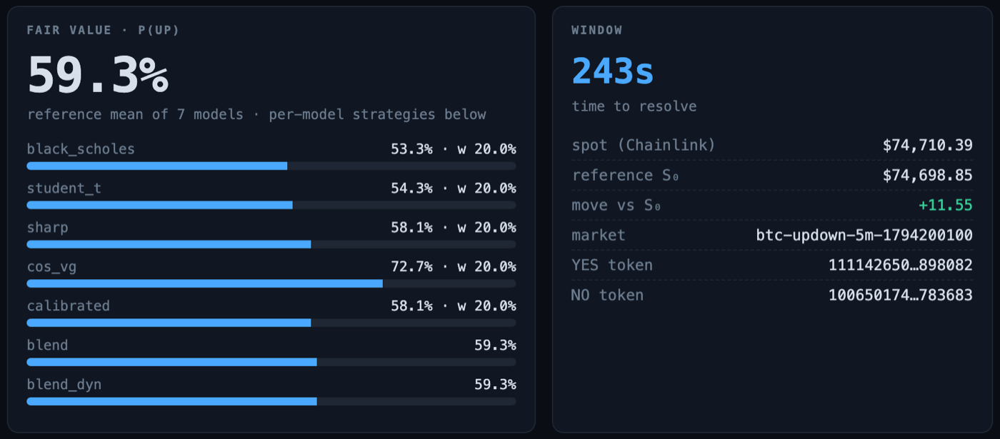
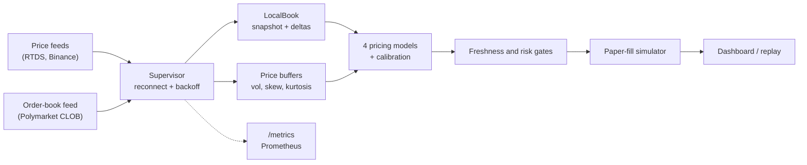

# Polymarket Pricing Research

[](https://github.com/arnav-goel10/polymarket-pricing-research/actions/workflows/ci.yml)
[](https://www.rust-lang.org/)
[](LICENSE)

A real-time market-data and pricing engine in Rust, run as a paper-only simulation. It reads public price and order-book feeds for Polymarket's five-minute Bitcoin up/down markets, rebuilds each order book locally, and estimates the probability of each outcome with four pricing models in about 1.3 microseconds. It never places an order.

| | |
| --- | ---: |
| Replay of a real 10-minute live recording (954k frames), every frame parsed and re-priced, sustained for 10 minutes ([raw](bench-results/soak-2026-11-09.log)) | **396,000 frames / s, 250× real time** |
| Per-frame latency on that recording, p50 / p99 ([raw](bench-results/2026-11-09.txt)) | **2.4 µs / 3.7 µs** |
| Order-book messages parsed and applied, one core ([raw](bench-results/2026-11-09.txt)) | **1.7 million / s** |
| Memory over the 10-minute soak ([raw](bench-results/soak-2026-11-09.csv)) | **flat, 6.5 to 7.7 MiB** |
| Fuzzing, 4 targets × 5 min ([raw](bench-results/fuzz/)) | **35 million inputs, 0 crashes** |
| Tests and line coverage ([tests](bench-results/ci-local.txt), [coverage](bench-results/coverage.txt)) | **231 tests, 69% of lines** |
| 10-minute live recording replayed, and a 150 s live check ([raw](bench-results/2026-11-09.txt), [live](bench-results/live-book-health.txt)) | **0 book resyncs, 0 crossed books** |

Measured on an Apple M5 laptop. Method and full tables are under [Benchmarks](#benchmarks).

> **Simulation boundary:** every decision and fill is a paper-fill simulation. The project has no wallet, signer or credentialed exchange client, and no external order-submission path. See the [publication boundary](docs/publication-boundary.md).



## Architecture



| Crate | Responsibility |
| --- | --- |
| `poly_core` | Shared types, validated configuration, reconnect backoff, lock-free feed counters. |
| `feeds` | WebSocket price feeds, the reconnect supervisor, and a scripted test server for fault injection. |
| `market` | Market discovery and order books. `LocalBook` rebuilds a book from a snapshot plus deltas and detects gaps, duplicates, malformed levels and crossed books. |
| `pricing` | Digital-option pricing models (Black-Scholes, Student-t, Cornish-Fisher, COS Variance-Gamma), online Platt calibration and model averaging. |
| `stats` | Rolling moments and volatility estimators. |
| `execution` | Paper-fill simulation, simulated strategy selection and paper risk limits. |
| `app` | Orchestration, the Axum dashboard and `/metrics`, event replay, benchmarks. |

More detail in [docs/architecture.md](docs/architecture.md).

## Reliability

Each feed runs under one supervisor. A dropped socket, 30 seconds of silence, or a book that can no longer be trusted ends the session. The supervisor then reconnects with exponential backoff from 250 ms to a 10 s cap, and a session that stayed up for 30 s resets the delay.

When the book cannot be trusted, it stops publishing and resyncs:

- **Gaps and duplicates.** With per-message sequence numbers, a repeated message is ignored and a missing one stops the book until a fresh snapshot arrives.
- **Malformed input.** One bad level (NaN, negative size, price outside 0 to 1) rejects the whole message, and the book resyncs.
- **Crossed books.** Polymarket reports fills as trades without removing the filled level, so a naive local book goes crossed several times a minute. Each delta carries the venue's own best bid and ask, and the book prunes through them before checking. A book that is still crossed triggers a resync.
- **Stale data.** A reference price older than 5 s or a book older than 3 s blocks every simulated decision, and `/metrics` flags any feed past its threshold.

Backpressure and lifecycle:

- **Bounded queues only.** The recorder takes raw frames through a 65,536-slot queue. When the disk falls behind it drops the newest frame and counts it in `poly_recorder_dropped_total`, so a feed task never blocks on I/O. A test pushes 200,000 1 KiB frames into a stalled 1,024-slot queue, and live heap grows by about 1.1 MB while 200 MB is offered ([test](crates/feeds/tests/backpressure.rs), [output](bench-results/backpressure.txt)). The dashboard uses a latest-value channel, so a slow browser holds at most one snapshot.
- **Graceful shutdown.** SIGTERM or SIGINT stops HTTP, gives open WebSockets 5 s, cancels the feeds, then drains and fsyncs the recorder. A test sends SIGTERM to the recorder mid-stream and checks for exit code 0 and a recording with every frame and no truncated tail ([`crates/app/tests/record_shutdown.rs`](crates/app/tests/record_shutdown.rs)). The app shut down in 5 ms in a live run ([`bench-results/app-shutdown.txt`](bench-results/app-shutdown.txt)).
- **Probes.** `/healthz` reports liveness and ignores the feeds, so an exchange outage does not trigger restarts. `/readyz` returns 503 until every feed is fresh.

How it is tested:

- **Property-based tests** ([`crates/market/tests/book_props.rs`](crates/market/tests/book_props.rs)) generate 512 random streams per property and replay them against a `BTreeMap` reference model, with duplicated, dropped, reordered, malformed and crossing messages. The book must match the reference exactly or report itself out of sync.
- **Fault injection** ([`crates/feeds/tests/fault_injection.rs`](crates/feeds/tests/fault_injection.rs), [`crates/market/tests/stream_faults.rs`](crates/market/tests/stream_faults.rs)) runs the real streaming loops against a local WebSocket server that drops connections mid-stream, sends garbage, goes silent, or refuses connections.
- **Fuzzing** ([`fuzz/`](fuzz/fuzz_targets)) runs the RTDS and Binance parsers, the order-book stream and the recording reader under libFuzzer. The book target also checks that every published book is sorted and uncrossed. The reader target checks that every record it accepts re-encodes to the same bytes.
- **Real data.** A 10-minute live recording (953,972 frames) replays with zero resyncs. A 4 MB slice is committed and replayed in CI ([`crates/app/tests/live_sample.rs`](crates/app/tests/live_sample.rs)).
- **Live check.** Before the book was trimmed to the venue's best bid and ask, the app resynced 6 times in its first 90 seconds on the public feed. After it, 150 seconds and 67,920 book updates produced no resync and no crossed book ([`bench-results/live-book-health.txt`](bench-results/live-book-health.txt)).

The old stream code had two bugs these tests target. It published crossed books, and it turned a malformed snapshot into a partial book. Both are recorded in [`bench-results/legacy-book-bugs.txt`](bench-results/legacy-book-bugs.txt).

## Observability

`GET /metrics` serves Prometheus text format for every feed: messages per second, feed lag (receive time minus exchange timestamp), seconds since the last message, reconnects, resyncs, malformed frames, connection state and a stale flag. A scrape from a live run:

```text
poly_feed_messages_per_second{feed="clob_book"} 1092.4
poly_feed_lag_seconds{feed="clob_book"} 0.123
poly_feed_resyncs_total{feed="clob_book"} 0
poly_feed_stale{feed="clob_book"} 0
```

Logs are structured `tracing` events. `LOG_FORMAT=json` prints one JSON object per line with fields such as `feed`, `retry_in_ms` and `error`.

[docs/RUNBOOK.md](docs/RUNBOOK.md) explains each signal, the alert it should drive and what to do. Alert rules are in [`ops/prometheus/alerts.yml`](ops/prometheus/alerts.yml) and a Grafana dashboard is in [`ops/grafana/poly-feeds.json`](ops/grafana/poly-feeds.json). Neither has been validated with promtool or loaded into Grafana yet. [docs/DESIGN.md](docs/DESIGN.md) covers requirements, data flow, trade-offs and failure modes.

## Recording and replay

`record` writes raw frames from all three feeds to an append-only file. Each record is length-prefixed and CRC-32 checked, and the file has a versioned header. A crash leaves a readable file up to the last complete record, and a corrupted record is never returned. Setting `RECORD_PATH` makes the app itself record while it runs.

```bash
cargo run --release -p app --bin record -- session.prec --secs 600
cargo run --release -p app --bin prec -- info session.prec
cargo run --release -p app --bin latency_report -- --recording session.prec
./scripts/soak.sh session.prec 600      # RSS every 10 s to bench-results/soak-<date>.csv
```

The 10-minute session used here is 425 MB, with 953,972 frames and none dropped ([`bench-results/live-recording.txt`](bench-results/live-recording.txt)). Verified reading runs at 2.7 GiB/s.

## Benchmarks

```bash
./scripts/bench.sh                                   # about 4 minutes; writes bench-results/<date>.txt
POLY_RECORDING=session.prec ./scripts/bench.sh       # also benchmark a full recording
```

Results from [`bench-results/2026-11-09.txt`](bench-results/2026-11-09.txt) (Apple M5, 10 cores, 16 GB, rustc 1.99.1). Times are Criterion medians.

| Benchmark | Result |
| --- | ---: |
| Apply one level update to a 20-level book (`LocalBook`) | 19.1 ns |
| Order-book message, JSON parse to published book | 599 ns (1.67 M msg/s) |
| Price one contract, Black-Scholes | 8.6 ns |
| Price one contract, COS Variance-Gamma (64 terms) | 1.25 µs |
| Price one contract, four-model ensemble | 1.32 µs |
| Read and checksum the 425 MB recording | 2.74 GiB/s |
| Replay the 10-minute recording through the pipeline | 256,000 frames/s |
| Merge three synthetic feeds into one time-ordered stream | 121 M events/s |
| Synthetic pipeline, 100k events, re-price on every event | 609,000 events/s |

Per-frame latency on the 10-minute live recording (`latency_report --recording`):

| Frames | Count | p50 | p99 | p99.9 |
| --- | ---: | ---: | ---: | ---: |
| All | 953,972 | 2.4 µs | 3.7 µs | 20.3 µs |
| Binance | 455,436 | 2.0 µs | 2.8 µs | 5.2 µs |
| Order book | 497,943 | 2.6 µs | 4.3 µs | 20.7 µs |
| Reference price | 590 | 3.8 µs | 4.5 µs | 5.3 µs |

These are processing costs, measured to show headroom. End to end, network lag (0.04 to 0.12 s in the live scrape above) and the engine's 250 ms decision tick dominate, and the pipeline keeps up with the live feed rate on a small fraction of one core. Throughput on the recording varies with the measurement. The Criterion median is 256,000 frames/s, with a wide interval of 216,000 to 317,000. A single timed pass gives 421,000, and the 10-minute soak sustained 396,000. Each latency sample includes one pair of clock reads. Real order-book frames run larger than synthetic ones, often carrying both outcome tokens, so they cost more than the 1.7 µs synthetic p50. The COS Variance-Gamma model takes most of the per-frame time.

## Research findings

I built the engine to find out whether digital-option models price these contracts well, and whether any apparent edge survives a correction for testing many correlated variants. The models forecast well. No simulated strategy holds up after the correction.

Source: the committed paper ledger [`fixtures/shadow-ledger-v1`](fixtures/shadow-ledger-v1) (5,000 paper-fill rows over 334 five-minute windows, 500 scored forecasts per model), summarised in [`demo/summary.json`](demo/summary.json) and the [research audit](docs/research-audit.md).

- **Forecasts.** All seven variants score a Brier of 0.096 to 0.101, against 0.249 for a constant forecast at the observed up-rate. The plain Student-t model scores best (Brier 0.0958, log loss 0.311). The ledger does not score the market mid on the same windows, so this does not show the models beat the market.
- **Simulated P&L.** 6 of 22 strategy cells have a bootstrap interval above zero before adjustment. None survives a Holm correction, and the smallest adjusted p-value is 0.374.

Limits of the evidence:

- Paper fills cannot reproduce queue position, rejected requests or execution latency.
- Model variants act on the same markets, so they are correlated alternatives.
- Online calibration can data-snoop unless parameters are frozen before a forward holdout.
- The ledger spans strategy revisions, so results should be read by version and window.

Reproduce:

```bash
python3 scripts/analyze_shadow_strategy.py --check --data fixtures/shadow-ledger-v1
python3 scripts/analyze_shadow_strategy.py --data fixtures/shadow-ledger-v1 --json demo/summary.json
cargo run -p app --bin replay -- fixtures/replay-sample.json --json
```

The read-only research demo is live at [arnav-goel10.github.io/polymarket-pricing-research](https://arnav-goel10.github.io/polymarket-pricing-research/), or serve it locally with `python3 -m http.server 8000 -d demo`.

## Quick start

Requirements: stable Rust, Python 3.10+, and a network connection for observing public feeds.

```bash
cp .env.example .env
cargo run -p app -- --mode shadow
```

The dashboard binds to `http://127.0.0.1:8080` by default, with metrics at `/metrics`.

| Mode | Network data | Simulated decisions | External orders | Default |
| --- | ---: | ---: | ---: | ---: |
| `shadow` | Yes | All strategies | Impossible | Yes |
| `dry-run` | Yes | Selected strategy | Impossible | No |

A non-loopback dry-run dashboard requires a random `CONTROL_TOKEN` of at least 32 characters. Without a token, the dashboard is read-only and `/control` is not registered.

The offline replay binary scores four model families on a versioned synthetic sample against the market-mid baseline:

```bash
cargo run -p app --bin replay -- fixtures/replay-sample.json --json
```

## Verification

```bash
cargo fmt --all --check
cargo clippy --workspace --all-targets -- -D warnings
cargo test --workspace --all-targets
python3 scripts/check_paper_only.py
python3 scripts/analyze_shadow_strategy.py --check --data fixtures/shadow-ledger-v1
cargo deny check                                     # advisories, licences, sources
cargo +nightly llvm-cov --workspace --summary-only   # coverage
cargo +nightly fuzz run recording_reader -- -max_total_time=300
```

CI also checks dependencies with cargo-deny, measures coverage, compiles the benchmarks, runs each fuzz target briefly, replays the committed recording, and builds and smoke-tests the container. The container job has not been run yet. CI fails if the committed research summary cannot be regenerated byte-for-byte.

## License

MIT. See [LICENSE](LICENSE).
